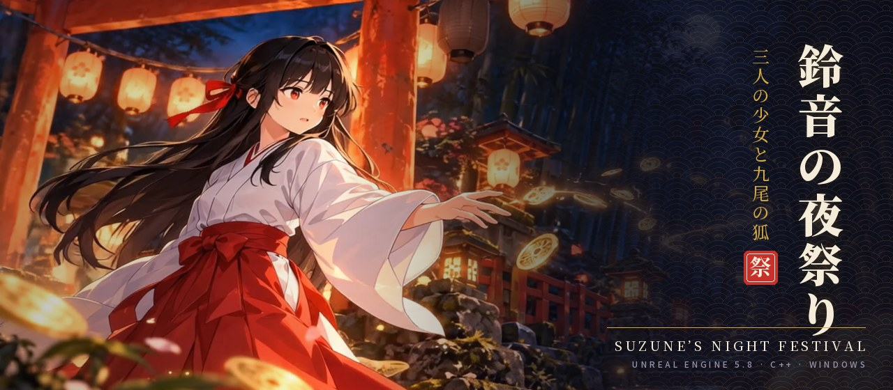
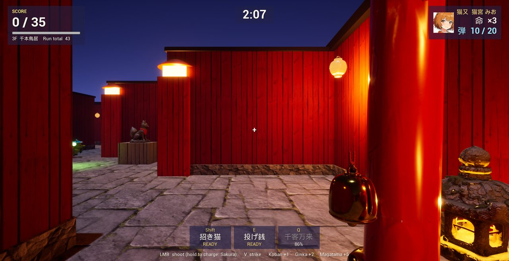
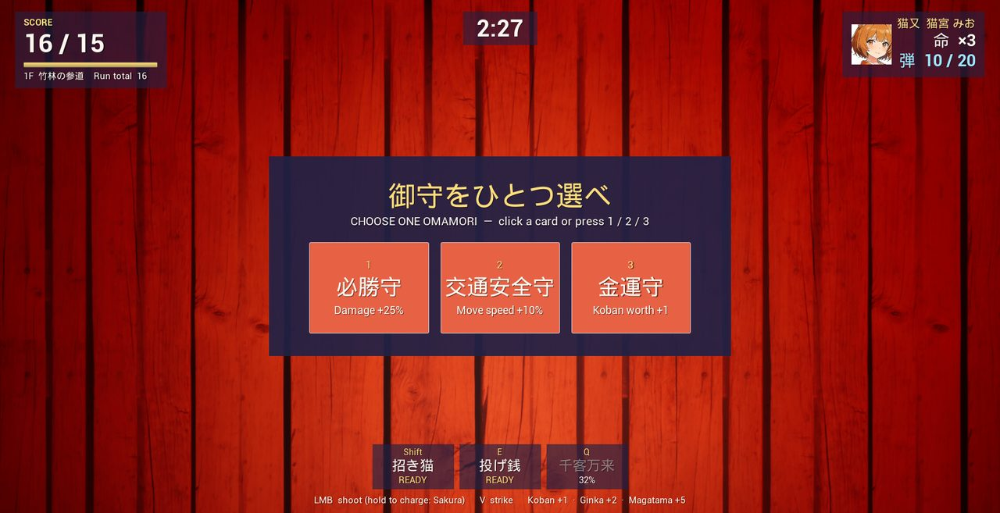
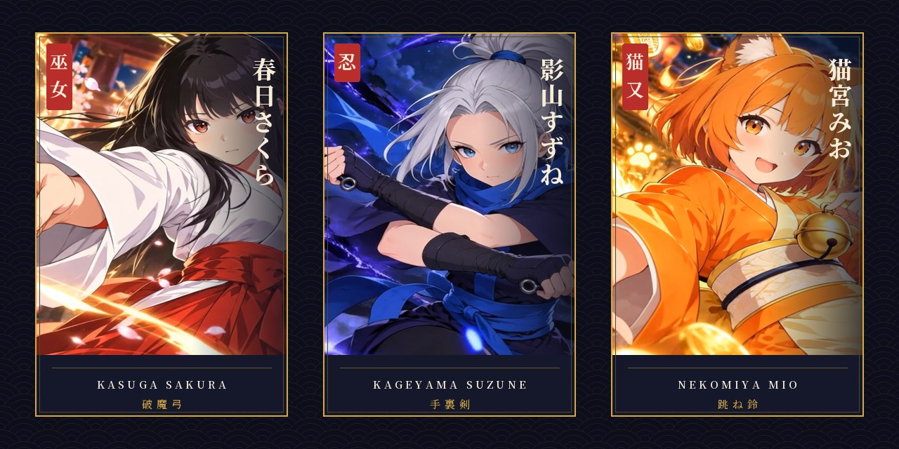
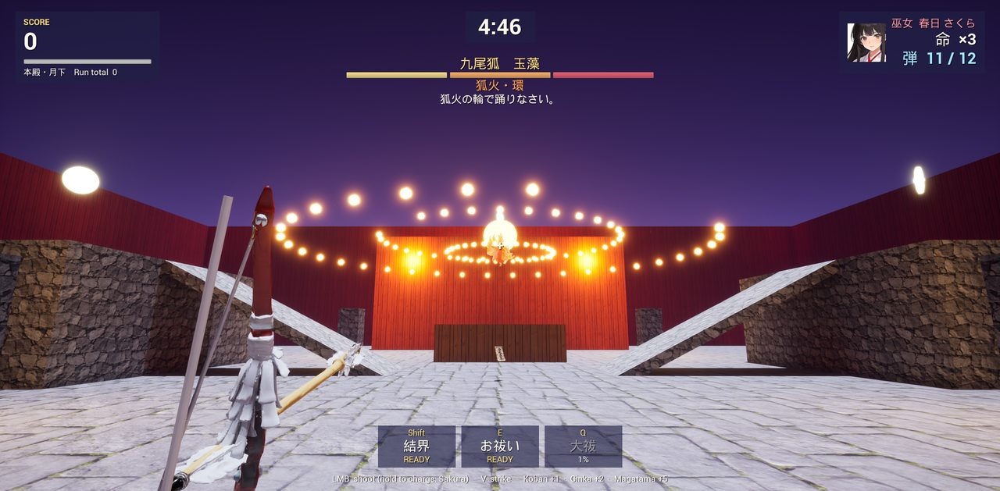
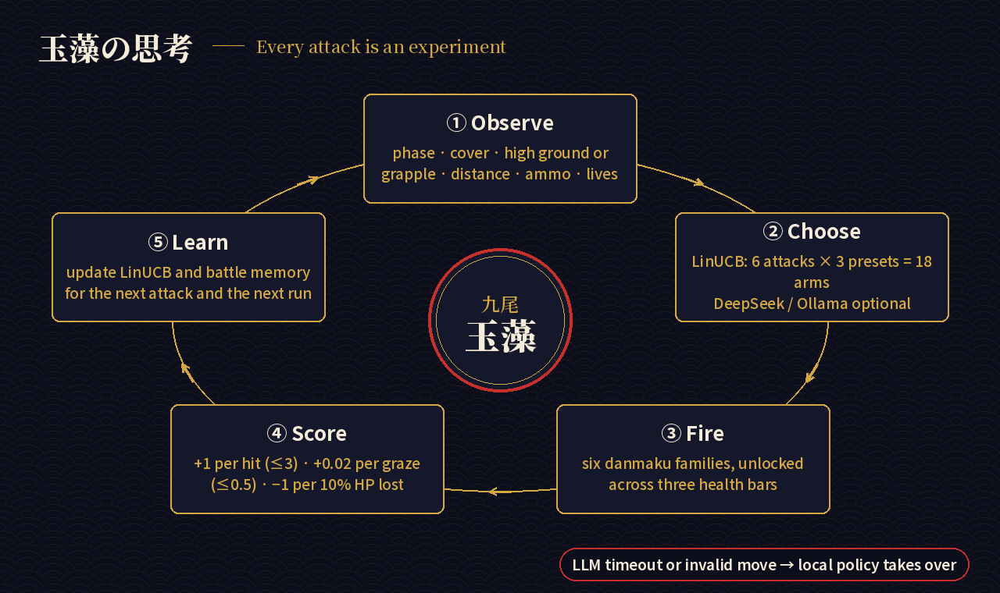
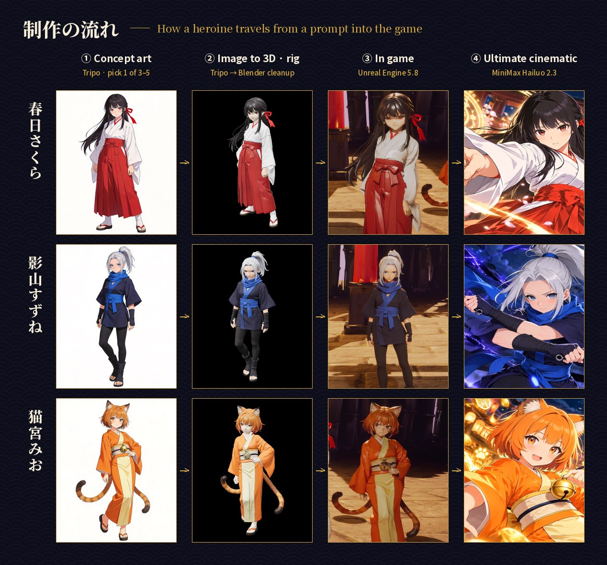
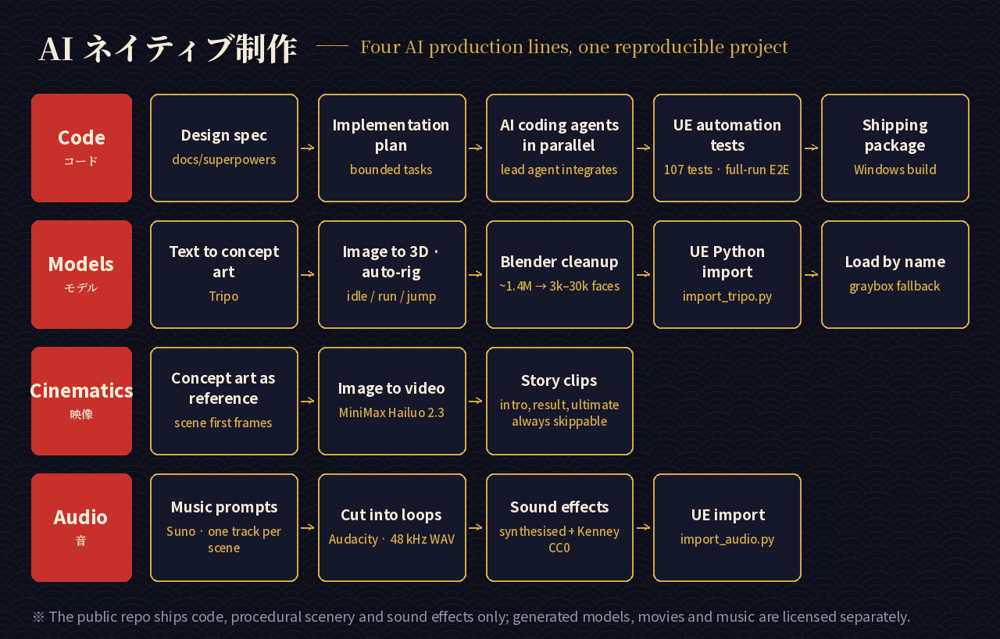
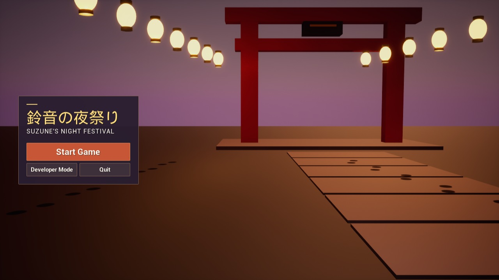

<h1 align="center"></h1>

<div align="center">

[简体中文](README.md) · **English**

[](https://github.com/jomify/suzune-matsuri/releases/latest)    [](LICENSE)

*Pick a heroine, cross three night-festival mazes, and face Tamamo, a nine-tailed fox who learns from every attack she makes.*

[**Download for Windows**](https://github.com/jomify/suzune-matsuri/releases/latest) · [I Play](#壱--the-festival-run-夜祭の歩き方) · [II Heroines](#弐--three-heroines-三人の少女) · [III Boss](#参--a-boss-that-learns-九尾の狐) · [IV AI workflow](#肆--an-ai-native-production-aiネイティブ制作) · [V Download](#伍--download-and-play-遊ぶ) · [VI Source](#陸--build-from-source-作る)

</div>

> [!NOTE]
> Screenshots and illustrations on this page come from the **full coursework demo**. Its character models, cinematics, music and some scenery are optional assets that need separate licences and are **not included** in the public source or playable build. The public build uses procedural scenery and placeholder models; see [Download and play](#伍--download-and-play-遊ぶ) for how it actually looks.

<p align="center"></p>

## 壱 · The festival run <sub>夜祭の歩き方</sub>

| 1F Bamboo path | ➝ | 2F Summer-night stalls | ➝ | 3F Thousand torii | ➝ | Main shrine under the moon |
| :---: | :---: | :---: | :---: | :---: | :---: | :---: |

On each floor, defeat yokai and collect wish coins to reach the target score before the timer runs out; the torii gate then opens. After each floor you choose one of three omamori charms to carry into the next. The run ends when time or lives run out, and losing all your health first plays a short death replay.

<table>
  <tr>
    <td width="50%"></td>
    <td width="50%"></td>
  </tr>
  <tr>
    <td align="center"><sub>3F Thousand torii · the deeper you go, the darker the night</sub></td>
    <td align="center"><sub>Pick one omamori after each floor</sub></td>
  </tr>
</table>

<p align="center"></p>

## 弐 · Three heroines <sub>三人の少女</sub>

<p align="center"></p>

| | Sakura · shrine maiden | Suzune · ninja | Mio · nekomata |
| --- | --- | --- | --- |
| **Weapon** | Charged piercing bow, +50 HP | Three-shuriken fan, +15% speed, double jump | Bouncing bell, bonus score from silver coins |
| `Shift` | **Kekkai**: 2 s invulnerability and knockback | **Shunshin**: blink up to the next wall | **Maneki-neko**: pull in coins and ammo |
| `E` | **Oharai**: stun cone ahead | **Bunshin**: decoy that draws aggro | **Nagezeni**: spend score to throw coins |
| `Q` | **Ōharae**: purge nearby yokai | **Kagenui**: 6 s of homing shots | **Senkyaku-banrai**: double drops for 8 s |

Each heroine’s ultimate plays her own cinematic; press `Esc` to skip it.

<p align="center"></p>

## 参 · A boss that learns <sub>九尾の狐</sub>



Tamamo has three health bars and six danmaku attack families. After every attack, the game records hits, grazes and the damage she took, turns them into a reward, and uses it to pick her next move.



| Phase | Attacks unlocked | What it forces the player to do |
| :---: | --- | --- |
| 1 | Kitsunebi Ring, Kitsunebi Spiral, Onibi Pursuit | Thread the gaps, circle-strafe, never stand still |
| 2 | + Nine-tail Sweep, Fox Rain | Jump onto platforms or hide behind cover, then get flushed out of it |
| 3 | + Phantom Blink | Cover stops working; reposition with barely a pause between attacks |

The default local LinUCB policy runs fully offline. Developer mode can plug in DeepSeek or Ollama, giving the model similar past fights and this run’s feedback as context. The player answers with cover, a grapple to the shrine’s glowing rings (`F`) and grazing. The reward formula and log fields are in the [boss AI design](docs/boss_plan.md) (Chinese).

<p align="center"></p>

## 肆 · An AI-native production <sub>AIネイティブ制作</sub>

Code, models, cinematics and music were all made with AI; people set the direction, picked the results and signed them off.





- **Code**: larger features start as a [design spec](docs/superpowers/specs/2026-10-30-story-health-replay-design.md) and becomes a [plan of bounded tasks](docs/superpowers/plans/2026-10-30-story-health-replay.md). Several AI coding agents implement the tasks in parallel, and a lead agent integrates, builds and verifies. 107 Unreal automation tests guard every change, including an end-to-end test that plays a whole run.
- **Models**: Tripo generates 3–5 concept images per heroine to choose from, then turns the pick into a 3D model, auto-rigs it and adds idle, run and jump animations. A [Blender script](tools/blender/normalize_matsuri.py) reduces the raw ~1.4M faces to 3k–30k and normalises scale, and a [UE Python script](tools/ue/import_tripo.py) imports everything in bulk. Task ids are written to a manifest before waiting, so an interrupted run resumes without paying twice.
- **Cinematics and sound**: first frames are made from the concept art and turned into video with MiniMax Hailuo 2.3. Music is written as per-scene [Suno prompts](docs/audio/suno_and_voice.md) (Chinese), cut into loops and [imported in bulk](tools/ue/import_audio.py). Sound effects are [synthesised by script](tools/audio/build_sfx.py) or come from Kenney’s CC0 packs.
- **Always playable**: the game loads art by name and falls back to graybox shapes when a file is missing, and skips missing movies. AI assets can be swapped, added or removed at any time, which is also why the public build runs without any licensed assets.

Every decision, cost and dead end is recorded in the [development log](docs/logbook.md) (Chinese).

<p align="center"></p>

## 伍 · Download and play <sub>遊ぶ</sub>



1. Download `SuzuneMatsuri-Windows-x64.zip` (about 323 MB) from [Releases](https://github.com/jomify/suzune-matsuri/releases/latest).
2. Extract the whole archive and run `SuzuneMatsuri.exe`.
3. Start a game from the title screen and press `1`, `2` or `3` to choose a heroine.

The build runs offline; you don’t need Unreal Editor or an API key. The image on the right is the public build as it really looks: procedural scenery, placeholder models and in-game sound effects. [Assets and licences](THIRD_PARTY_NOTICES.md) (Chinese)

<br clear="right">

| Action | Keys |
| --- | --- |
| Move, look, jump | `W A S D`, mouse, `Space` |
| Shoot, melee | Left mouse button, `V`. Hold the button to charge Sakura’s bow |
| Skills, ultimate | `Shift`, `E`, `Q` |
| Grapple | Aim at a glowing ring in the main shrine and press `F`; press `Space` to let go early |
| Choose a heroine or omamori | `1`, `2`, `3` |
| Skip a cinematic or ultimate animation | `Esc` |

<p align="center"></p>

## 陸 · Build from source <sub>作る</sub>

You need Windows, Unreal Engine 5.8, Visual Studio 2022 with the C++ game development workload and the Windows SDK, and Git LFS.

```bash
git lfs install
git clone https://github.com/jomify/suzune-matsuri.git
cd suzune-matsuri
git lfs pull
```

Open `SuzuneMatsuri/SuzuneMatsuri.uproject` in UE 5.8, then open `/Game/Matsuri/Maps/L_Title` and press Play to start from the main menu. Run the commands below in Git Bash; the scripts assume `C:/Program Files/Epic Games/UE_5.8`.

```bash
bash tools/build.sh build
bash tools/ue_cmd.sh smoke '-ExecCmds=Automation RunTests SuzuneMatsuri.E2E.CoreLoop' '-TestExit=Automation Test Queue Empty' -UserDir=../logs/smoke-user -nullrhi
bash tools/package.sh Shipping
```

The package lands in `Package/Windows/`. Tests that depend on the optional movies, music or character models need those assets. Developer mode can jump to any floor or show off the danmaku. To use DeepSeek, pass your key through the local `DEEPSEEK_API_KEY` environment variable.

| Where | What |
| --- | --- |
| [Game C++ source](SuzuneMatsuri/Source/SuzuneMatsuri/Matsuri/) | About 20k lines: level generation, combat, boss decisions and UI, plus about 7.7k lines of tests |
| [Code guide](docs/code-guide/README.md) (Chinese) | Find any file, class or function, with the call chain of a full run |
| [Boss AI design](docs/boss_plan.md) · [Game design](docs/design_plan.md) (Chinese) | Attacks, rewards, learning strategy and gameplay design |
| [Development log](docs/logbook.md) (Chinese) | Iterations, AI generation costs and implementation notes |

<p align="center"></p>

<p align="center"><sub>Original code is MIT licensed; the Unreal Engine samples and Kenney sound effects keep their own licences. <a href="LICENSE">MIT licence</a> · <a href="THIRD_PARTY_NOTICES.md">Assets and licences</a></sub></p>
