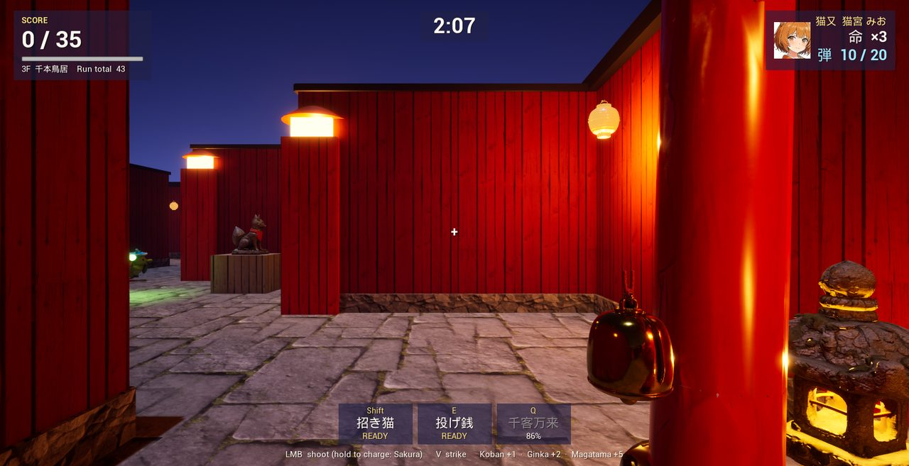
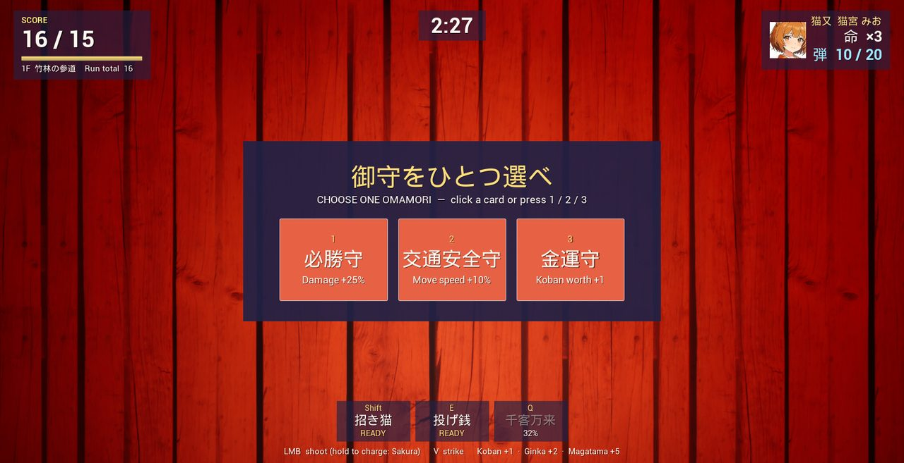
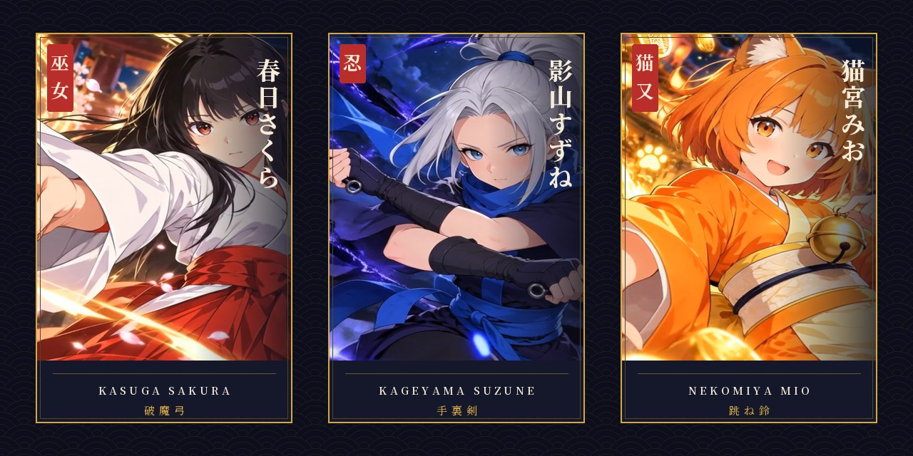
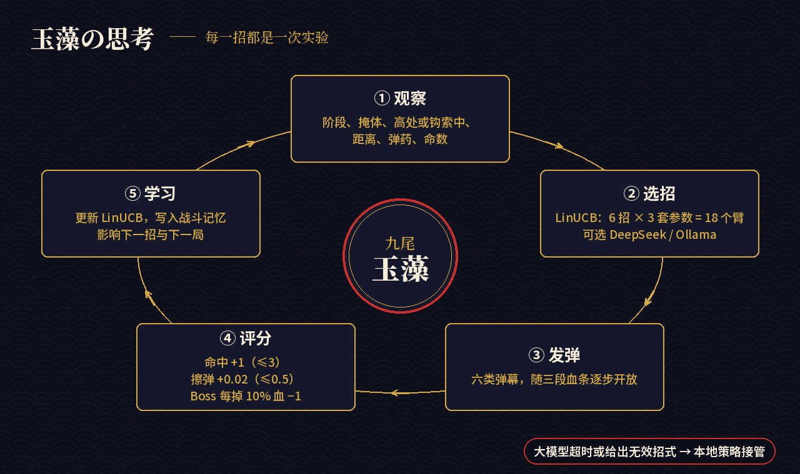
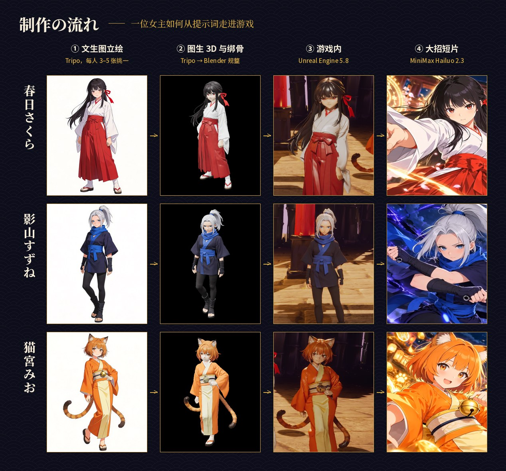
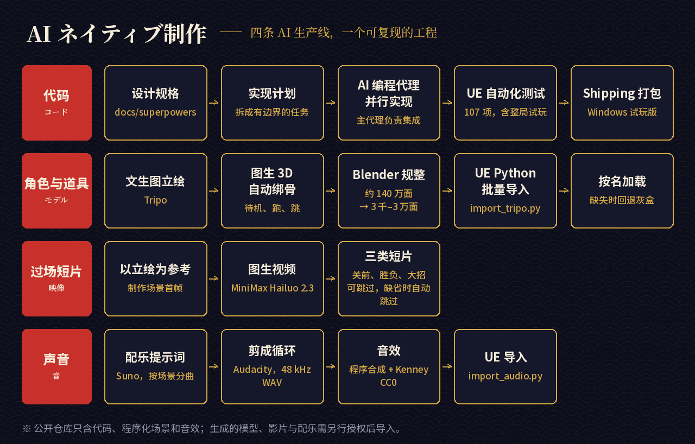

<h1 align="center"></h1>

<div align="center">

**简体中文** · [English](README.en.md)

[](https://github.com/jomify/suzune-matsuri/releases/latest)    [](LICENSE)

*选一名少女，穿过三层夜祭迷宫，在月下本殿迎战会从每一招中学习的九尾狐玉藻。*

[**下载 Windows 试玩版**](https://github.com/jomify/suzune-matsuri/releases/latest) · [壱 玩法](#壱--夜祭の歩き方-一局夜祭) · [弐 女主](#弐--三人の少女-三位女主) · [参 Boss](#参--九尾の狐-会学习的-boss) · [肆 AI 工作流](#肆--ai-ネイティブ制作-ai-原生工作流) · [伍 试玩](#伍--遊ぶ-下载试玩) · [陸 源码](#陸--作る-从源码运行)

</div>

> [!NOTE]
> 本页的游戏截图与插画来自课程**完整演示**。其中角色模型、剧情影片、配乐与部分场景属于需另行授权的可选素材，**不包含**在公开源码和试玩版中。公开版使用程序化布景与占位模型，实际画面见 [伍 · 遊ぶ](#伍--遊ぶ-下载试玩)。

<p align="center"></p>

## 壱 · 夜祭の歩き方 <sub>一局夜祭</sub>

| 1F 竹林の参道 | ➝ | 2F 夏祭りの夜店街 | ➝ | 3F 千本鳥居 | ➝ | 本殿・月下 |
| :---: | :---: | :---: | :---: | :---: | :---: | :---: |

每层都在倒计时内打倒妖怪、收集祈愿钱，达到目标分数后鸟居打开。过关时从三枚御守中选一枚带入下一层。倒计时耗尽或命数用完，本局结束；血量归零时会先播放死亡回放。

<table>
  <tr>
    <td width="50%"></td>
    <td width="50%"></td>
  </tr>
  <tr>
    <td align="center"><sub>3F 千本鳥居 · 越往深处，夜色越浓</sub></td>
    <td align="center"><sub>过关后三选一的御守</sub></td>
  </tr>
</table>

<p align="center"></p>

## 弐 · 三人の少女 <sub>三位女主</sub>

<p align="center"></p>

| | 春日さくら · 巫女 | 影山すずね · 忍 | 猫宮みお · 猫又 |
| --- | --- | --- | --- |
| **武器** | 蓄力穿透弓，额外 50 HP | 三连扇形手里剑，移速 +15%、二段跳 | 会反弹的铃铛，银币额外加分 |
| `Shift` | **結界**：2 秒无敌并击退 | **瞬身**：瞬移到墙前 | **招き猫**：吸引金币与弹药 |
| `E` | **お祓い**：前方扇形眩晕 | **分身**：留下吸引仇恨的替身 | **投げ銭**：消耗分数发射金币 |
| `Q` | **大祓**：净化周围妖怪 | **影縫い**：6 秒追踪射击 | **千客万来**：8 秒双倍掉落 |

每位女主的大招都有专属过场动画，按 `Esc` 可跳过。

<p align="center"></p>

## 参 · 九尾の狐 <sub>会学习的 Boss</sub>


玉藻有三段血条和六类弹幕。每放完一招，游戏都会记录这一招的命中、擦弹和玉藻自身掉血，换算成奖励，再用来调整下一次选招。



| 阶段 | 开放的招式 | 逼玩家做什么 |
| :---: | --- | --- |
| 一 | 狐火・環、狐火・螺旋、鬼火・追 | 找缝钻过去、绕圈走位、不能站着不动 |
| 二 | ＋ 九尾薙ぎ、狐の雨 | 跳上平台或躲到掩体后，再被逼离开掩体 |
| 三 | ＋ 幻影・瞬身 | 掩体失效，重新找位置；招与招之间几乎不停 |

默认使用本地 LinUCB 策略，离线即可运行。开发者模式可接入 DeepSeek 或 Ollama，把相似的历史战况和本局反馈作为上下文。玩家这边有掩体、本殿挂环上的钩索（`F`）和擦弹。奖励公式与日志字段见 [Boss AI 设计](docs/boss_plan.md)，实现见 [Boss 源码导读](docs/code-guide/02-boss.md)。

<p align="center"></p>

## 肆 · AI ネイティブ制作 <sub>AI 原生工作流</sub>

代码、模型、影像和配乐都在 AI 协作下完成；人负责定方向、挑选和验收。





- **代码**：较大的功能先写[设计规格](docs/superpowers/specs/2026-10-30-story-health-replay-design.md)，再拆成有边界的[实现计划](docs/superpowers/plans/2026-10-30-story-health-replay.md)，由多个 AI 编程代理并行实现，主代理负责集成、编译和验证。107 项 UE 自动化测试是每次合入前的护栏，其中端到端测试会自动试玩完整一局。
- **模型**：Tripo 先出 3–5 张立绘供挑选，再图生 3D、自动绑骨并套上待机、跑、跳动画。[Blender 脚本](tools/blender/normalize_matsuri.py)把约 140 万面的原始模型减到 3 千–3 万面并统一尺寸，[UE Python 脚本](tools/ue/import_tripo.py)批量导入。生成任务的 id 先写进清单再等待结果，中断重跑不会重复扣费。
- **影像与声音**：以立绘为参考制作首帧，用 MiniMax Hailuo 2.3 图生视频；配乐按场景写成 [Suno 提示词](docs/audio/suno_and_voice.md)，剪成循环后[批量导入](tools/ue/import_audio.py)。音效由[脚本合成](tools/audio/build_sfx.py)或取自 Kenney CC0。
- **随时可玩**：游戏按名字加载美术资源，缺失时自动退回灰盒，缺少影片时自动跳过。AI 素材因此可以随时替换、补上或撤下，公开版也能在没有任何授权素材的情况下完整运行。

每一步的取舍、花费和踩过的坑都记录在[开发日志](docs/logbook.md)里。

<p align="center"></p>

## 伍 · 遊ぶ <sub>下载试玩</sub>


1. 从 [Releases](https://github.com/jomify/suzune-matsuri/releases/latest) 下载 `SuzuneMatsuri-Windows-x64.zip`（约 323 MB）。
2. 完整解压，运行 `SuzuneMatsuri.exe`。
3. 在标题画面开始游戏，按 `1` `2` `3` 选择女主。

试玩版可以离线运行，不需要安装 Unreal Editor 或配置 API 密钥。右图是公开版的实际画面：程序化布景、占位模型和游戏音效。 [素材与许可](THIRD_PARTY_NOTICES.md)

<br clear="right">

| 操作 | 按键 |
| --- | --- |
| 移动、转向、跳跃 | `W A S D`、鼠标、`Space` |
| 射击、近战 | 鼠标左键、`V`。樱可按住左键蓄力 |
| 角色技能、大招 | `Shift`、`E`、`Q` |
| 钩索 | 在本殿对准发光挂环按 `F`，按 `Space` 提前松开 |
| 选择女主或御守 | `1`、`2`、`3` |
| 跳过剧情或大招动画 | `Esc` |

<p align="center"></p>

## 陸 · 作る <sub>从源码运行</sub>

需要 Windows、Unreal Engine 5.8、Visual Studio 2022 的 C++ 游戏开发工具和 Windows SDK，以及 Git LFS。

```bash
git lfs install
git clone https://github.com/jomify/suzune-matsuri.git
cd suzune-matsuri
git lfs pull
```

用 UE 5.8 打开 `SuzuneMatsuri/SuzuneMatsuri.uproject`。打开 `/Game/Matsuri/Maps/L_Title` 并按 Play，可从主菜单进入游戏。以下命令在 Git Bash 中运行，脚本默认使用 `C:/Program Files/Epic Games/UE_5.8`。

```bash
bash tools/build.sh build
bash tools/ue_cmd.sh smoke '-ExecCmds=Automation RunTests SuzuneMatsuri.E2E.CoreLoop' '-TestExit=Automation Test Queue Empty' -UserDir=../logs/smoke-user -nullrhi
bash tools/package.sh Shipping
```

打包输出为 `Package/Windows/`。依赖可选影片、配乐或角色模型的测试需要相应素材。开发者模式可跳到指定关卡或展示弹幕。接入 DeepSeek 时，通过本机环境变量 `DEEPSEEK_API_KEY` 传入密钥。

| 入口 | 内容 |
| --- | --- |
| [游戏 C++ 代码](SuzuneMatsuri/Source/SuzuneMatsuri/Matsuri/) | 约 2 万行：关卡生成、战斗、Boss 决策、UI；另有约 7,700 行测试 |
| [中文代码导读](docs/code-guide/README.md) | 按文件、类和函数查找实现，附一局游戏的调用链 |
| [Boss AI 设计](docs/boss_plan.md) · [课程设计](docs/design_plan.md) | 招式、奖励、学习策略与玩法设计 |
| [开发日志](docs/logbook.md) · [答辩问答](docs/答辩问答.md) | 迭代记录、AI 生成花费与实现说明 |

<p align="center"></p>

<p align="center"><sub>项目自有代码采用 MIT 许可证，UE 示例和 Kenney 音效沿用各自的许可。 <a href="LICENSE">MIT 许可证</a> · <a href="THIRD_PARTY_NOTICES.md">素材与许可</a></sub></p>
