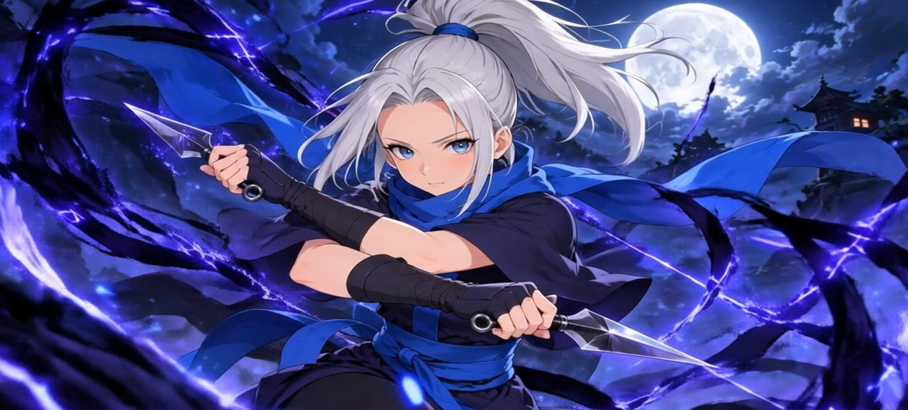
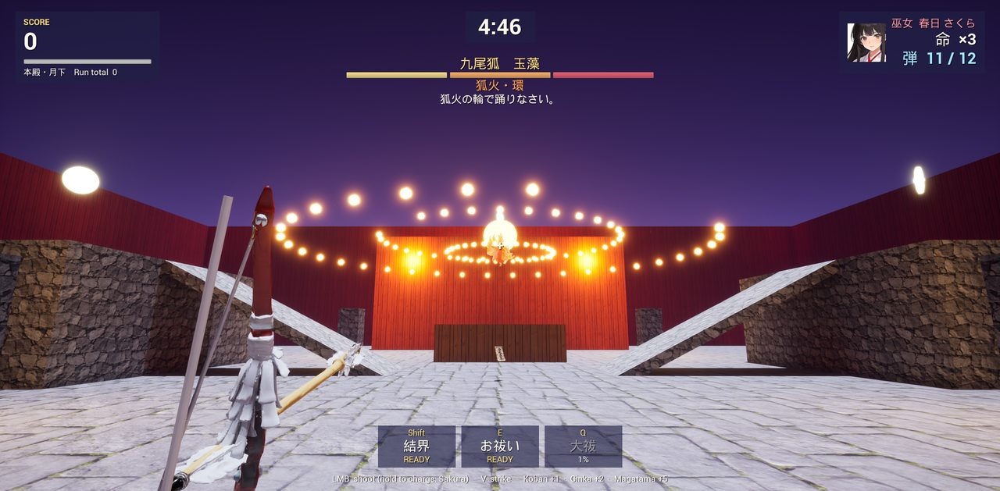
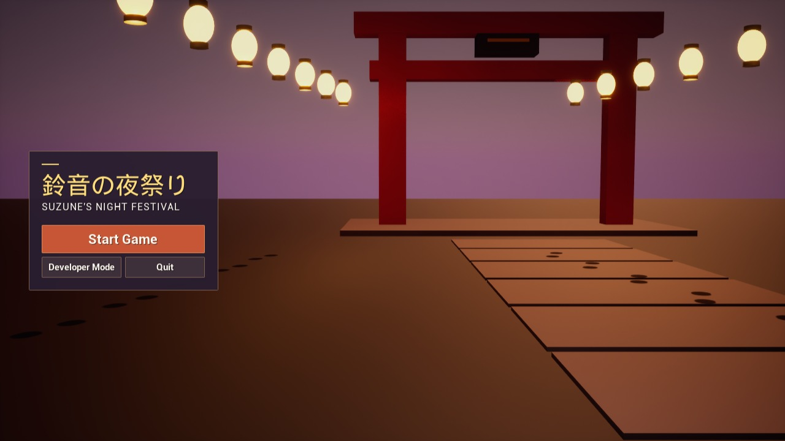

<div align="center">

# 鈴音の夜祭り · Suzune’s Night Festival

**选一名女主，穿过三层夜祭迷宫，在月下本殿迎战会从每一招中学习的九尾狐玉藻。**

[](https://github.com/jomify/suzune-matsuri/releases/latest)    [](LICENSE)

[**下载 Windows 试玩版**](https://github.com/jomify/suzune-matsuri/releases/latest) · [玩法](#一局夜祭) · [三位女主](#三位女主) · [Boss AI](#玉藻会学习的-boss) · [从源码运行](#从源码运行) · [代码导读](docs/code-guide/README.md)

</div>


> [!NOTE]
> 本页截图来自课程**完整演示**。其中角色模型、剧情插画、配乐与部分场景属于需另行授权的可选素材，**不包含**在公开源码和试玩版中。公开版使用程序化布景与占位模型，画面见 [下载试玩](#下载试玩)。

**English** — *Suzune’s Night Festival* is a single-player first-person action game built with Unreal Engine 5.8 and C++. Pick one of three heroines, clear three timed festival mazes, then face Tamamo, a nine-tailed fox whose danmaku boss AI picks each attack with a LinUCB contextual bandit (optionally an LLM) based on hits, grazes and the damage she takes. The free Windows build runs offline.

## 一局夜祭

| 1F 竹林の参道 | → | 2F 夏祭りの夜店街 | → | 3F 千本鳥居 | → | 本殿・月下 |
| :---: | :---: | :---: | :---: | :---: | :---: | :---: |

每层都在倒计时内打倒妖怪、收集祈愿钱，达到目标分数后鸟居打开。过关时从三枚御守中选一枚带入下一层。倒计时耗尽或命数用完，本局结束；血量归零时会先播放死亡回放。

<table>
  <tr>
    <td width="50%"></td>
    <td width="50%"></td>
  </tr>
  <tr>
    <td align="center"><sub>3F 千本鳥居 · 夜色迷宫</sub></td>
    <td align="center"><sub>过关后三选一的御守</sub></td>
  </tr>
</table>

## 三位女主

<table>
  <tr>
    <th width="33%">春日さくら · 巫女</th>
    <th width="33%">影山すずね · 忍者</th>
    <th width="33%">猫宮みお · 猫又</th>
  </tr>
  <tr>
    <td></td>
    <td></td>
    <td></td>
  </tr>
  <tr>
    <td valign="top"><b>蓄力穿透弓</b>，额外 50 HP<br><code>Shift</code> 結界：2 秒无敌并击退<br><code>E</code> お祓い：前方扇形眩晕<br><code>Q</code> 大祓：净化周围妖怪</td>
    <td valign="top"><b>三连扇形手里剑</b>，移速 +15%、二段跳<br><code>Shift</code> 瞬身：瞬移到墙前<br><code>E</code> 分身：留下吸引仇恨的替身<br><code>Q</code> 影縫い：6 秒追踪射击</td>
    <td valign="top"><b>会反弹的铃铛</b>，银币额外加分<br><code>Shift</code> 招き猫：吸引金币与弹药<br><code>E</code> 投げ銭：消耗分数发射金币<br><code>Q</code> 千客万来：8 秒双倍掉落</td>
  </tr>
</table>

上图为三人大招的专属过场动画，按 `Esc` 可跳过。

## 玉藻：会学习的 Boss



玉藻有三段血条和六类弹幕。每放完一招，游戏记录这一招的命中、擦弹和玉藻自身掉血，换算成奖励，用来调整下一次选招。

| 阶段 | 开放的招式 | 逼玩家做什么 |
| --- | --- | --- |
| 一 | 狐火・環、狐火・螺旋、鬼火・追 | 找缝钻过去、绕圈走位、不能站着不动 |
| 二 | ＋ 九尾薙ぎ、狐の雨 | 跳上平台或躲到掩体后，再被逼离开掩体 |
| 三 | ＋ 幻影・瞬身 | 掩体失效，重新找位置；招与招之间几乎不停 |

- **本地策略（默认）**：LinUCB 上下文多臂老虎机，在 6 招 × 3 套参数 = 18 个臂中选择。上下文包括阶段、玩家是否在掩体后、高处或钩索中，以及距离、弹药和命数。
- **大模型策略（可选）**：在开发者模式接入 DeepSeek 或 Ollama，把相似的历史战况和本局反馈作为上下文。模型超时或返回无效招式时，自动交回本地策略。
- **玩家的工具**：掩体、本殿挂环上的钩索（`F`），以及擦弹。

机制、奖励公式和日志字段见 [Boss AI 设计](docs/boss_plan.md)，实现见 [Boss 源码导读](docs/code-guide/02-boss.md)。

## 下载试玩



1. 从 [Releases](https://github.com/jomify/suzune-matsuri/releases/latest) 下载 `SuzuneMatsuri-Windows-x64.zip`（约 323 MB）。
2. 完整解压，运行 `SuzuneMatsuri.exe`。
3. 在标题画面开始游戏，按 `1` `2` `3` 选择女主。

试玩版可以离线运行，不需要安装 Unreal Editor 或配置 API 密钥。右图是公开版的实际画面：使用程序化布景、占位模型和游戏音效，缺省的剧情影片会自动跳过。 [素材与许可](THIRD_PARTY_NOTICES.md)

<br clear="right">

| 操作 | 按键 |
| --- | --- |
| 移动、转向、跳跃 | `W A S D`、鼠标、`Space` |
| 射击、近战 | 鼠标左键、`V`。樱可按住左键蓄力 |
| 角色技能、大招 | `Shift`、`E`、`Q` |
| 钩索 | 在本殿对准发光挂环按 `F`，按 `Space` 提前松开 |
| 选择女主或御守 | `1`、`2`、`3` |
| 跳过剧情或大招动画 | `Esc` |

## 从源码运行

需要 Windows、Unreal Engine 5.8、Visual Studio 2022 的 C++ 游戏开发工具和 Windows SDK，以及 Git LFS。

```bash
git lfs install
git clone https://github.com/jomify/suzune-matsuri.git
cd suzune-matsuri
git lfs pull
```

用 UE 5.8 打开 `SuzuneMatsuri/SuzuneMatsuri.uproject`。打开 `/Game/Matsuri/Maps/L_Title` 并按 Play，可从主菜单进入游戏。以下命令在 Git Bash 中运行，脚本默认使用 `C:/Program Files/Epic Games/UE_5.8`。

```bash
bash tools/build.sh build
bash tools/ue_cmd.sh smoke '-ExecCmds=Automation RunTests SuzuneMatsuri.E2E.CoreLoop' '-TestExit=Automation Test Queue Empty' -UserDir=../logs/smoke-user -nullrhi
bash tools/package.sh Shipping
```

打包输出为 `Package/Windows/`。依赖可选影片、配乐或角色模型的测试需要相应素材。开发者模式可跳到指定关卡或展示弹幕。接入 DeepSeek 时，通过本机环境变量 `DEEPSEEK_API_KEY` 传入密钥。

## 工程概览

约 2 万行游戏 C++ 代码，另有约 7,700 行测试代码，共 107 项 UE 自动化测试，包括自动试玩整局流程的端到端测试。

| 入口 | 内容 |
| --- | --- |
| [游戏 C++ 代码](SuzuneMatsuri/Source/SuzuneMatsuri/Matsuri/) | 关卡生成、战斗、Boss 决策、UI 与自动化测试 |
| [中文代码导读](docs/code-guide/README.md) | 按文件、类和函数查找实现，附一局游戏的调用链 |
| [Boss AI 设计](docs/boss_plan.md) · [课程设计](docs/design_plan.md) | 招式、奖励、学习策略与玩法设计 |
| [开发日志](docs/logbook.md) · [答辩问答](docs/答辩问答.md) | 迭代记录与实现说明 |

## 许可

项目自有代码采用 MIT 许可证，UE 示例和 Kenney 音效沿用各自的许可。 [MIT 许可证](LICENSE) · [素材与许可](THIRD_PARTY_NOTICES.md)
