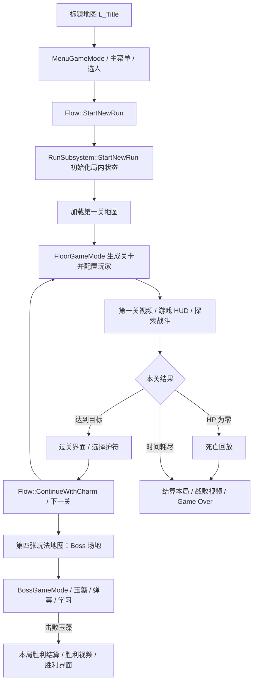

# 《鈴音の夜祭り》中文代码导读

本导读依据 2026-11-03 工作区代码整理，适合从“游戏功能在哪里实现”开始阅读。正文按模块解释文件、类和函数，不逐行翻译语法。

## 先理解工程结构

`SuzuneMatsuri/Source/SuzuneMatsuri/` 是主要 C++ 源码位置。里面的 `Matsuri/` 是夜祭游戏自定义系统；同级的角色、控制器和镜头代码提供基础能力。`Variant_Shooter/`、`Variant_Horror/` 是保留的模板功能，不能因为名字带 Shooter 就认为当前武器系统在其中。

| 文档 | 包含内容 |
| --- | --- |
| [01 核心规则与游戏流程](01-core.md) | 角色定义、分数、生命值、护符、局内状态、跨关状态、存档、GameMode、回放、音画资源与开发开关 |
| [02 Boss 与学习系统](02-boss.md) | 玉藻、六种技能、逐弹伤害、弹幕模拟、场地、钩索、LLM、ICL/ICRL、LinUCB、记忆与提示词 |
| [03 战斗、敌人、拾取与关卡](03-gameplay.md) | 普攻、近战、三角色技能、武器模型、投射物、特效、妖怪 AI、迷宫生成与布景 |
| [04 界面与视频](04-ui.md) | 主菜单、选人、HUD、过关与死亡页面、加载转场、视频播放、回放界面、开发面板 |
| [05 测试](05-tests.md) | 每个测试文件、测试入口与辅助函数，以及它实际验证的行为 |
| [06 基础框架、模板与工具](06-framework-and-tools.md) | 工程入口、Character、PlayerController、CameraManager、模板代码、构建配置、资源生成和导入脚本 |

范围覆盖项目 `Source/` 中的手写 `.h`、`.cpp`、`.cs`，以及 `tools/` 中的源码脚本；自动生成的代码、构建产物和临时日志不作为手写代码讲解。每章介绍具名函数，包括构造函数、私有辅助函数、头文件内联函数。重要匿名回调随所属函数解释，不逐一给没有名字的 lambda 单列条目。引擎宏生成的函数也不当作项目手写函数。

`.uasset`、`.umap` 是 UE 二进制资产，可能包含蓝图逻辑、输入映射、材质节点和场景配置，不能把这份 C++ 导读视为它们的逐节点说明。`SourceArt/` 是原始素材，`Content/Movies/` 是播放用视频，`Saved/` 是运行结果、存档和日志。

## .h 与 .cpp 分别看什么

以 `MatsuriCombatComponent.h/.cpp` 为例：

- `.h` 声明这个组件“有什么能力”：能开火、近战、进入大招锁定；同时列出它保存的状态和向外发送的事件。
- `.cpp` 实现这些能力“具体怎样完成”：检查弹药、计算发射方向、生成投射物、播放音效等。
- 有些很短的函数直接写在 `.h` 中，例如读取状态的 `Get...()`；因此只看 `.cpp` 会漏掉一部分函数。

常见 UE 名词：

| 写法 | 可以怎样理解 |
| --- | --- |
| `AActor` / `A...` | 世界中的对象，如妖怪、Boss、投射物、回放导演 |
| `ACharacter` | 能走、跳并具有碰撞和移动组件的角色 |
| `UActorComponent` / `U...Component` | 挂在对象上的功能模块，如战斗、技能、钩索 |
| `UUserWidget` / `U...Widget` | 菜单、HUD、视频等界面 |
| `F...` 结构体 | 一组数据或不依赖场景对象的计算规则，如局内状态、一次 Boss 决策 |
| `E...` 枚举 | 有限选项，如角色、技能、伤害结果、结束原因 |
| `GameMode` | 当前关卡的规则和流程管理者 |
| `UGameInstanceSubsystem` | 依附整个游戏实例，换地图后仍存在的系统 |
| `UCLASS` / `USTRUCT` / `UPROPERTY` / `UFUNCTION` | 让 UE 能识别类型、属性和函数，参与编辑器、序列化、蓝图或垃圾回收等功能；实际作用由具体标记决定 |
| `On...` 事件 / delegate | 发生事情时通知监听者，例如受伤后刷新界面 |
| `Super::...()` | 先执行父类同名函数的基础行为 |
| `Try...()` | 尝试执行，通常通过返回值说明是否成功 |
| `const` | 该函数或引用承诺不通过这个接口修改对象状态 |

## 一局游戏怎样跑起来

图中视频可能关闭或播放失败，这时流程会直接继续。普通关卡有三层迷宫，随后进入 Boss 场地。时间耗尽不播放死亡回放；HP 归零才尝试回放，历史不足时也会跳过。

UE 生命周期不是从一个手写 `main()` 逐句跑到结尾。引擎负责创建对象，在合适时间调用项目覆写的函数：

1. **构造函数**：设置组件和默认参数，不代表已经进入游戏。
2. **`Initialize()`**：例如跨关子系统启动时加载记录。
3. **`SetPlayerDefaults()`**：关卡为玩家安装战斗、技能、武器外观等能力。
4. **`BeginPlay()`**：对象正式进入玩法，绑定事件、创建 UI、启动关卡。
5. **`Tick()` / `TickComponent()`**：逐帧推进，如计时、弹幕运动、AI 和视觉更新。
6. **输入、碰撞、事件回调**：按键、命中、死亡、视频结束等触发对应处理函数。
7. **`EndPlay()` / `NativeDestruct()`**：对象或界面退出时解绑、释放计时器并清理状态。

具体创建先后由 UE 调度，以上是帮助阅读的职责顺序，不是所有对象共用的一条固定调用栈。

## 四条最值得先读的调用链

### 普通攻击

`UMatsuriCombatComponent` 绑定鼠标输入 → `HandleFirePressed()`、`HandleFireHeld()`、`HandleFireReleased()` → `TryFire()` 检查能否发射并根据角色武器参数组装 `FMatsuriShot` → `SpawnShot()` 生成 `AMatsuriProjectile` → 投射物依据 `Matsuri::Shots::BallisticsFor()` 等规则推进并检测命中 → 对妖怪或 Boss 施加伤害 → 音效、特效和 HUD 命中反馈。

樱的蓄力弓、铃音的散射手里剑、澪的弹跳铃铛共用这个框架，但参数、弹道和命中处理不同。角色的普通攻击投射物与 Boss 的批量弹幕是两套实现。

### 玩家受伤

妖怪、陷阱或 Boss 子弹请求伤害 → `AMatsuriFloorGameMode::HurtPlayer()` 检查关卡状态、无敌和伤害合法性 → `UMatsuriRunSubsystem::HurtPlayer()` → `FMatsuriRunState::Hurt()` 扣生命值或消耗狐狸祝福 → 返回受伤结果 → 广播界面事件；真正扣血后获得短暂无敌，致命时尝试死亡回放。

这三层分别负责“当前世界怎么处理”“对外提供状态服务和通知”“纯数据怎样变化”。所以有三个相似的受伤函数，它们的职责不同。

### 按 Q 使用大招

`UMatsuriSkillComponent::TryUseSkill(Q)` → 检查充能和锁定 → `Perform()` 分派到当前角色的大招 → 成功后消费充能 → 锁住攻击和技能 → `UMatsuriCinematicWidget::TryPlay()` 播放对应角色视频 → 完成、跳过或失败后解除锁定。

当前代码先执行大招效果，再开始最长 2.5 秒的动画插入；播放时暂停世界。视频缺失不会取消已经成功的大招。

### Boss 的一次学习

`AMatsuriBoss` 收集玩家状态 → `BrainComponent::Observe/Complete` 补充近期习惯 → `Prepare()` 从记忆取相似案例、拼入本局轨迹和笔记并异步请求模型 → `Decide()` 使用合法且及时返回的模型答案，或者本地学习器/规则 → `BossSkills` 生成攻击 → `DanmakuField` 推进子弹并统计结果 → `StepFinished()` 算奖励、保存记录并更新 LinUCB → 战斗结束后 `Reflect()` 请求反思笔记。

ICL 是给模型看过去的相似案例；ICRL 是给模型看本局已经发生的“动作与奖励”；LinUCB 是本地独立更新的数值学习器。这里没有训练或修改 DeepSeek 的模型权重。展示模式会按顺序演示技能，并跳过正常学习记录。

## 想改某个功能，先找哪里

| 要改的内容 | 首先阅读 |
| --- | --- |
| 基础 HP、治疗、弹药、大招充能 | `Core/MatsuriRunState`、`MatsuriRunSubsystem` |
| 三位角色差异和武器参数 | `Core/MatsuriHeroes`；发射逻辑看 `Combat/MatsuriCombatComponent`，弹道看 `Combat/MatsuriProjectile` |
| Shift、E、Q 的实际效果 | `Combat/MatsuriSkillComponent` |
| 普攻、近战和按键行为 | `Combat/MatsuriCombatComponent` |
| 普通怪物和陷阱 | `Enemies/MatsuriYokai`、`MatsuriYokaiBrain`、`MatsuriYokaiKinds`、`MatsuriHazards` |
| Boss 每颗子弹伤害 | `Boss/MatsuriBossSkills::BulletDamageFor`；弹体数据在 `MatsuriDanmaku`，实际扣血经过 `MatsuriDanmakuField` |
| Boss 选技能、学习与提示词 | `Boss/MatsuriBossBrainComponent`、`MatsuriBossLearner`、`MatsuriBossPrompt`、`MatsuriBossMemory` |
| 地图大小、目标分、时限、主题 | `Level/MatsuriFloors`、`MatsuriFloorLayout`、`MatsuriMaze` |
| 生成场景、灯光、布景 | `Level/MatsuriFloorBuilder`、`MatsuriFloorDecor`；Boss 场地看 `Boss/MatsuriBossArena` |
| 死亡回放 | `Core/MatsuriReplay`、`UI/MatsuriReplayWidget` |
| 五段剧情与三段大招视频 | `UI/MatsuriCinematicWidget`；剧情触发在 `MatsuriFloorGameMode`，大招触发在 `MatsuriSkillComponent` |
| 分数、结算与存档 | `Core/MatsuriScoreState`、`MatsuriRecord`、`MatsuriSaveGame`、`MatsuriRunSubsystem` |
| 三渲二改造入口 | `tools/ue/create_materials.py`、`Level/MatsuriFloorBuilder`、`Core/MatsuriArt`；当前尚不能据此认为已实现卡通渲染 |

建议先读 `MatsuriRunState` → `MatsuriRunSubsystem` → `MatsuriFloorGameMode`，再顺着自己最关心的功能追到组件。先理解“数据在哪、谁调用谁”，再看数学、碰撞和异步细节，会更容易把文件联系起来。

## 本次文档核对范围

共核对 231 个源码文件：215 个 C++ 头文件/实现文件、3 个 C# 构建文件、13 个工具脚本。逐章解释，并核对文件名、头文件声明候选、Python 函数和 99 个注册测试类的说明是否出现；本地链接逐一检查目标存在。正则提取用于辅助找漏项，不等同于编译器的完整语义分析；括号初始化的常量和迭代器变量已人工排除。

核对结果见 [verification.json](verification.json)。本次只增加导读和项目 README 入口，没有修改玩法源码，也没有重新运行游戏、模型请求或自动化游戏测试。蓝图、材质和动画资产内部仍需在 UE 编辑器里查看。
